# Kế hoạch xây dựng Exam Suite cho iOS (bản Học viên)

Soạn: 21/10/2026 · Trạng thái: **DRAFT, chờ Nt0 review và chốt mục "Quyết định cần Nt0 chốt trước I0"**; chưa phải thẩm
quyền sản phẩm cho tới khi được duyệt. Cùng phạm vi v1 / v1.1 và cùng tài liệu `docs/product/mobile.md` với
[plan-android-v1.md](plan-android-v1.md). **Thứ tự: Nt0 chốt 2026-10-22 làm Android trước, iOS sau** (Q13 của plan
Android); bảng Quyết định của plan này chốt khi bắt đầu iOS. Phần rà soát cách làm bản macOS ở [notes/ra-soat-cach-lam-macos.md](../notes/ra-soat-cach-lam-macos.md); quy tắc
chống test trùng ở plan Android Phần 4; cả hai không chép lại.

## Tóm tắt

Xây app iPhone **chỉ cho học viên luyện tập**, phạm vi v1 và v1.1 đúng như plan Android Phần 1. Khác Android ở một
điểm quyết định chi phí: **lõi và tầng dữ liệu của bản macOS dùng lại nguyên** (ExamKit, ExamFile chỉ `import
Foundation` theo ADR 0008; LibraryData không có SwiftUI/AppKit), và model trình bày của làm bài, Kết quả, Xem lại là
Swift thuần nên tách ra dùng chung được. Chỉ viết mới phần view cho màn hẹp và phần nhận file của iOS. Không có lõi thứ
hai, không cần oracle parity.

| Hạng mục | Đề xuất |
| --- | --- |
| Công nghệ | Swift 6, SwiftUI, SwiftData (kho hiện có), iOS 18+ (cùng thế hệ SDK với macOS 15 mà repo đang dùng; iPhone XS/XR 2018 trở lên) |
| Lõi | ExamKit, ExamFile, LibraryData dùng nguyên; thêm `.iOS(.v18)` vào `platforms` của hai Package.swift |
| Giao diện | Tách model trình bày khỏi AppKit thành module dùng chung cho macOS và iOS; view iPhone viết mới trong target mới |
| Repo | Cùng `project.yml`, target `ExamSuiteiOS` (bundle ID `vn.io.nt0.examsuite.ios`), UI test `ExamSuiteiOSUITests` dùng chung `Apps/UITestSupport` |
| Quy mô | **v1: 5 PR code, 3 cổng** (1 PR rủi ro cao vì chạm ranh giới package, không PR nào về lõi); v1.1: 3 PR |
| Kiểm thử | Dùng lại mọi lớp hiện có (`check.sh`, snapshot, XCUITest, `check_localization.py`, bảng màu); mới chỉ có ảnh snapshot iPhone, 3 lần mở app XCUITest trên simulator, ~15 test cho phần iOS thêm |
| Phân phối | TestFlight (Apple Developer Program 99 USD/năm; bản đầu qua Beta App Review; mỗi bản hết hạn sau 90 ngày) hoặc Ad Hoc (100 máy/năm, cần UDID); không cài file trực tiếp được |
| Ràng buộc | Cổng GA2, GA3 cần **một iPhone thật**; hiện Nt0 chưa có (QI5) |

## Phần 1 · Vì sao iOS rẻ hơn về code nhưng khó hơn về cổng

Số đo từ repo tại `main` 265ab44 (21/10/2026): `wc -l`, `grep` `import AppKit` và các kiểu `NS*`.

| Module | Dòng | File dính AppKit | Trên iOS |
| --- | --- | --- | --- |
| ExamKit + ExamFile | 3.685 | 0 | Dùng nguyên |
| LibraryData | 3.012 | 0 (một dòng chú thích nhắc `NSOpenPanel`) | Dùng nguyên; `AppLaunchStorage` (chế độ cô lập của UI test) cũng dùng được |
| LibraryFeature | 3.859 | 5 / 25 (`LibraryModel`, `LibraryStyle`, `PaletteColors`, `PresentationTermination`, `Localized`) | Tách phần không AppKit: `InterfaceStrings`, `InterfaceLocale`, `ErrorMessages`, `LibraryFormat`, `LibraryPalette`, `LibraryModelTypes`, `EntryStatusPresentation`, `LibraryAccessibility`, `LibraryPreferences` |
| SessionFeature | 6.696 | 7 / 25 (`SessionAppController`, `ContentZoom`, `ReadingSurface`, `ReadingPalette`, `SessionStyle`, `ResultsReportSheet`, `Localized`) | Tách phần model (~2.400 dòng, không AppKit): `AttemptModel`, `AttemptModelTypes`, `PreExamModel`, `ResultsModel`, `AnswerReviewModel`, `SessionCoordinator`, `SessionFormat`, `PlainMarkdown` |
| ReportFeature | 2.509 | 3 / 15 (hộp Lưu, hộp In, hộp báo lỗi) | v1.1: bộ dựng PDF (`ImageRenderer` → `CGContext`) chạy trên iOS, chỉ thay ba hộp bằng share sheet |

Hệ quả so với Android: không có bước viết lại lõi (A1 của Android, PR rủi ro cao lớn nhất), không có tầng dữ liệu mới
(A2), hạ tầng kiểm có sẵn (Xcode, snapshot, XCUITest, `verify_local.sh`). Đổi lại:

- **Cổng cần máy thật.** Simulator chạy được luồng 1–3, snapshot, XCUITest, mở `.exam` từ app Files và Safari, lưu
  phiên dở khi vào nền; **không** chạy được VoiceOver bằng cử chỉ, không nhận file từ Zalo/Drive thật, không mô phỏng
  hệ điều hành giết tiến trình khi thiếu bộ nhớ, không đo hiệu năng đề 2.000 câu trên phần cứng thật, không cài qua
  TestFlight. Bốn thứ đầu đều là mục test tay ở cổng GA2.
- **Thủ tục phát hành dài hơn**: đăng ký Apple Developer (xác minh danh tính thường mất vài ngày), chứng chỉ, Beta App
  Review cho bản TestFlight đầu, bản hết hạn sau 90 ngày phải đẩy lại.
- **Mọi PR iOS chạm module dùng chung đều chạy lại kiểm macOS** (snapshot, UI test đủ bộ theo bảng map), vì
  SessionFeature và LibraryFeature là module dùng chung mọi cửa sổ.

## Phần 2 · Phạm vi

Đúng danh sách v1 / v1.1 / Không làm / Ngoài phạm vi của plan Android Phần 1. Chỉ ghi chỗ iOS khác Android trong cách
thực hiện; quy tắc sản phẩm chung của mobile ở `mobile.md`:

| Chủ đề | iOS |
| --- | --- |
| Mở `.exam` từ app khác | `CFBundleDocumentTypes` cho UTType `.exam` của repo (đã khai báo cho macOS), `onOpenURL`; chia sẻ từ Zalo/Drive/Files vào app; **sao chép** vào container của app như Android (không mở tại chỗ), rồi thu hồi quyền truy cập |
| Thêm đề | `fileImporter` của SwiftUI |
| Xuống nền | `scenePhase` → `.inactive`/`.background` thì tạm dừng và lưu phiên dở; phiên dở là **file JSON trong container**, không đổi schema SwiftData (QI7) |
| Đồng hồ | `SuspendingClock` của lõi dùng nguyên (không chạy khi máy ngủ) |
| Bảng câu hỏi | Sheet với detent; cột bên trên iPad ở v1.1 |
| Cỡ chữ | Dynamic Type (chữ dùng kiểu hệ thống), không có menu Phóng to; `ContentZoom` của macOS không đem sang |
| Nền đọc | Không đem sang ở v1 (năm bộ màu của macOS là tính năng của cửa sổ lớn); theo sáng/tối hệ thống |
| Xuất PDF | v1.1: `ResultsReport` + `ReportRenderer` dùng nguyên, `ShareLink`/share sheet thay hộp Lưu, In qua `UIPrintInteractionController` |
| Ngôn ngữ | Theo hệ thống và ngôn ngữ riêng cho app (iOS 13 trở lên, Settings › App), String Catalog hiện có (vi nguồn, en) |
| Tên app | Exam Suite; bundle ID `vn.io.nt0.examsuite.ios` (QI3) |

## Phần 3 · Kiến trúc

```text
Packages/ExamKit                 không đổi; platforms thêm .iOS(.v18)
Packages/ExamFeatures
├── LibraryData                  không đổi
├── InterfaceCore   (MỚI)        tách từ LibraryFeature: tra chữ, locale, câu báo lỗi theo mã, định dạng, bảng màu,
│                                kiểu của Thư viện; chỉ Foundation + SwiftUI (Color), không AppKit
├── SessionModel    (MỚI)        tách từ SessionFeature: AttemptModel, PreExamModel, ResultsModel, AnswerReviewModel,
│                                SessionCoordinator, SessionFormat, PlainMarkdown; chỉ ExamKit + LibraryData + InterfaceCore
├── LibraryFeature, SessionFeature, ReportFeature, StudentShell   macOS như cũ, phụ thuộc hai module mới
├── MobileFeature   (MỚI)        view iPhone: Library, PreExam, Attempt, Results, Review, History; DraftSessionStore;
│                                nhận file; chỉ iOS (platforms .iOS); phụ thuộc InterfaceCore, SessionModel, LibraryData
└── MobileShell     (MỚI)        App, scene, onOpenURL, scenePhase, AppLaunchStorage (chế độ cô lập)
Apps/StudentiOS                  điểm vào, Info.plist (document types, InfoPlist.xcstrings), Assets
Apps/StudentiOSUITests           XCUITest trên simulator, dùng Apps/UITestSupport
```

- **Vì sao tách module thay vì chép** (QI2): Kết quả, Xem lại, Trước khi thi có nhiều quy tắc hợp đồng (hideAnswers, câu
  đã sửa, so với lần trước, lý do khoá) đã có ~130 test; chép sang iOS là có hai bản phải sửa song song, đúng cái bẫy
  "hai luồng PDF" của macOS. Tách ra thì macOS và iOS cùng một nguồn, test của model đi theo code (tên test không đổi).
- **Ranh giới**: `MobileFeature`/`MobileShell` không được phụ thuộc `AuthoringFeature`, `AuthoringData`, `ExamImport`
  (ADR 0003, thêm dòng cho target iOS vào `check_boundaries.py` và `check_bundle_boundary.sh`); `InterfaceCore`,
  `SessionModel` không `import AppKit`/`UIKit` (luật mới của `check_boundaries.py`, có đối chứng âm); ReportFeature chuyển
  sang phụ thuộc `InterfaceCore` thay vì `LibraryFeature` nếu chỉ cần tra chữ (luật 8 cập nhật).
- **String Catalog khi chuyển file giữa target**: khoá của code chuyển đi sẽ xuất hiện ở catalog của target mới chưa có
  bản `en`. Đề xuất (QI6): một script dời đúng các mục đó từ catalog cũ sang catalog mới (chạy một lần trong I1, không
  commit script), rồi `xcodebuild -exportLocalizations` hai scheme phải không đổi gì và `check_localization.py
  --require-en` xanh; không sửa tay từng khoá.
- **Chế độ cô lập của UI test** dùng lại `AppLaunchStorage` (kho, đề mẫu, cài đặt trong thư mục tạm của simulator,
  bundle ID đuôi `.uitest`); simulator đã tách dữ liệu khỏi Mac nên phần so kho thật của `verify_local.sh` không áp cho
  iOS.
- **Thư viện**: không thêm gói nào (ZIPFoundation hỗ trợ iOS; swift-snapshot-testing chạy trên simulator).

## Phần 4 · Lộ trình cho agent

Nguyên tắc như plan Android Phần 3: mỗi bước một PR, tài liệu đi cùng PR code, kết luận spike vào Decisions. Nếu Android
đã làm trước, `mobile.md` và ADR mobile chung đã có; I0 chỉ bổ sung phần iOS.

### v1: 5 PR, 3 cổng

```mermaid
gantt
  title iOS v1: 5 PR, 3 cổng
  dateFormat X
  axisFormat %s
  I0 Chuẩn bị, ADR, target iOS rỗng, spike   :i0, 0, 1
  I1 Tách InterfaceCore, SessionModel (rủi ro cao) :i1, after i0, 2
  GI1 macOS không đổi (snapshot, UI test đủ bộ)     :milestone, after i1, 0
  I2 Làm bài → Xem lại trên iPhone           :i2, after i1, 2
  I3 Thư viện, Trước khi thi, nhận file      :i3, after i2, 2
  GI2 dùng thử trên iPhone thật              :milestone, after i3, 0
  I4 Hoàn thiện, TestFlight, đóng plan v1    :i4, after i3, 1
  GI3 v1.0 riêng                             :milestone, after i4, 0
```



| Bước | Đầu ra | Phụ thuộc | Rủi ro / review | Kiểm chứng trong PR |
| --- | --- | --- | --- | --- |
| **I0 Chuẩn bị** (1 PR, agent + Nt0 chốt QI1–QI8 trước) | ADR iOS (iOS 18, SwiftUI, dùng lại lõi, tách model trình bày, target trong cùng `project.yml`; số ADR theo thứ tự lúc làm); `docs/product/mobile.md` (tạo nếu chưa có); exec-plan `docs/plans/active/ios-v1.md`; AGENTS.md thêm mục iOS; `platforms` thêm `.iOS(.v18)`; target `ExamSuiteiOS` và `ExamSuiteiOSUITests` rỗng trong `project.yml` build được trên simulator; `verify_local.sh` thêm bước build + test iOS (simulator) khi PR chạm target iOS hay module dùng chung, status vẫn một `local/verify` (mô tả thêm "iOS ok"); `uitest_plan.py` thêm dòng map; `check_boundaries.py`, `check_bundle_boundary.sh`, `check_localization.py --built-apps` biết app iOS. **Spike** ghi Decisions: biên dịch ExamKit, ExamFile, LibraryData cho simulator (kỳ vọng 0 lỗi); đếm lỗi theo file khi biên dịch LibraryFeature, SessionFeature cho iOS để chốt danh sách file tách ở I1; nhận `.exam` từ Files/Share sheet với UTType hiện có; SwiftData `LibrarySchemaV1` mở trên iOS; snapshot test chạy trên simulator trong target `ExamFeaturesSnapshotTests` (ADR 0010) qua `xcodebuild test -destination 'platform=iOS Simulator'` hay cần target thứ hai (nếu cần: sửa ADR 0010 trong cùng PR I1) | — | Thường (chạm `project.yml`, scripts: người duyệt xem kỹ, không review độc lập vì chưa có hành vi app) | `verify_local.sh` xanh với bước iOS mới; kết quả macOS không đổi |
| **I1 Tách model trình bày** (1 PR) | `InterfaceCore`, `SessionModel` theo Phần 3; LibraryFeature, SessionFeature, ReportFeature, hai shell chuyển sang phụ thuộc; dời khoá catalog bằng script (QI6); luật mới của `check_boundaries.py`; test hiện có đi theo code (đổi target, không đổi nội dung); **không đổi hành vi macOS** | I0 | **Cao** (chạm `Package.swift`, ranh giới hai bản): 1 review độc lập; `verify_local.sh --uitest` đủ bộ vì chạm module dùng chung | Snapshot macOS không đổi ảnh; `swift test` ExamFeatures cùng số test; `-exportLocalizations` không đổi catalog; `check_bundle_boundary.sh` hai app macOS như cũ. **Cổng GI1**: Nt0 chỉ đọc status |
| **I2 Làm bài → Xem lại trên iPhone** (1 PR) | `MobileFeature` view: Làm bài (câu, ảnh phóng to, lựa chọn A–Z theo vị trí, bảng câu hỏi sheet, đồng hồ ba mức, cảnh báo 5/1 phút, che khi tạm dừng, Kiểm tra đáp án), Rà soát & nộp, Kết quả, Xem lại, Luyện lại câu sai, Làm lại; `AttemptModel` dùng nguyên, thêm lớp mỏng cho `scenePhase` và phiên dở qua giao thức (fake trong PR này); Dynamic Type; VoiceOver nhãn; sáng/tối | I1 | Thường | ~10 test cho phần iOS thêm (tạm dừng theo `scenePhase`, lưu/khôi phục phiên dở, nhãn theo vị trí trên sheet); **không** test lại `AttemptModel` (đã có 31 test đi theo module); snapshot iPhone sáng/tối: câu dài 10 lựa chọn, ảnh lớn, Kết quả nhiều phần, Xem lại `hideAnswers` (8 ảnh, `#if os(iOS)` trong target snapshot) |
| **I3 Thư viện, Trước khi thi, nhận file** (1 PR) | Thư viện danh sách (tìm/sắp xếp từ `LibraryModel` dùng chung, Xoá + Hoàn tác, dải chào mừng, đề mẫu lần đầu), Thêm đề (`fileImporter`), `onOpenURL` + document types, sao chép vào container, Cập nhật đề, Trước khi thi (sheet dạng form, `PreExamModel` dùng nguyên), Lịch sử → Kết quả cũ, `NavigationStack`, `DraftSessionStore` thật (file JSON), mỗi lúc một phiên | I2 | Thường (cao nếu phải đổi LibraryData cho sao chép file) | ~5 test (sao chép và Cập nhật đề, phiên dở ghi/đọc); XCUITest trên simulator **3 lần mở app** (chế độ cô lập): luồng 1 (Luyện tập tới Xem lại, Luyện lại câu sai); luồng 2 mở đầu bằng mở file `.exam` qua `xcrun simctl openurl`/Files rồi Thi, hết giờ với `-ExamSuiteUITestTimeScale` có sẵn; luồng 3 (vào nền tạm dừng, mở lại đúng chỗ); `performAccessibilityAudit` (iOS 17+) qua `AccessibilityAuditor` có sẵn trong ba test này; snapshot Thư viện danh sách (2 ảnh). **Cổng GI2**: Nt0 cài bản Debug lên iPhone mượn (hoặc TestFlight nội bộ), làm trọn một đề thật |
| **I4 Hoàn thiện và beta** (1 PR + Nt0) | Rà nhanh VoiceOver bốn màn chính trên máy thật; đo tay đề chuẩn 2.000 câu trên iPhone, ghi `docs/notes/ios-measurements.md`, sửa mục vượt ngân sách; cấu hình ký và TestFlight (team, profile do Nt0 giữ), `MARKETING_VERSION` chung với macOS hay riêng (QI4), CHANGELOG, hướng dẫn cài TestFlight trong `docs/install.md`, sửa lỗi beta từ GI2, đóng exec-plan v1 | I3 | Thường | Không test mới (bảng màu dùng chung đã có `PaletteContrastTests`); `verify_local.sh --clean --uitest` trên SHA phát hành; **Cổng GI3** |

Ước lượng: 5 PR; I1 là PR nặng nhất về review (di chuyển ~4.000 dòng, không đổi hành vi) và là PR duy nhất chạm bản
macOS đã phát hành. Thời gian lịch tương đương Android v1 (4–6 ngày) nhưng **cộng thời gian chờ Apple Developer và chờ
mượn iPhone**, nên nếu không có hai thứ đó sẵn thì chậm hơn Android.

### v1.1: 3 PR, 1 cổng

| Bước | Đầu ra | Kiểm chứng |
| --- | --- | --- |
| **J1 PDF kết quả** | exec-plan `ios-v1.1.md`; `ResultsReport`, `ReportRenderer`, `ReportFileWriter` dùng nguyên; `ShareLink`/share sheet và `UIPrintInteractionController` thay ba hộp của macOS; ảnh JPEG co theo trang nếu Nt0 chốt Q9 cho cả hai mobile | Không test luật ẩn/hiện (đã có ở SessionFeatureTests, đi theo `SessionModel`); 2 smoke PDF trên simulator; Xuất PDF nối vào đuôi XCUITest luồng 1 |
| **J2 iPad và giao diện mở rộng** | `NavigationSplitView`, cột bên cho bảng câu hỏi, Thư viện lưới (`ExamGridView` của macOS xem dùng lại được không), Thông tin đề, lọc, Khôi phục đề mẫu | Snapshot iPad sáng/tối (3 màn) |
| **J3 Trợ năng sâu và đo** | Rà VoiceOver theo bảng mục tiêu, Reduce Motion, test `Timing` của `LargeExamSupport` chạy trên simulator nếu số đo tay sát ngân sách; đóng exec-plan v1.1; **Cổng GI4** trên iPhone và iPad | Số đo chỉ ghi |

### Thứ tự merge và nhánh

`feature/ios-i0` → `feature/ios-i1` → `feature/ios-i2` → `feature/ios-i3` → `feature/ios-i4`; không có cặp song song trong
v1 (I2 và I3 cùng viết `MobileFeature`). Nếu có hai agent, phần "sao chép file vào container + `DraftSessionStore`" của
I3 tách được làm song song với I2 vì chỉ chạm `MobileFeature/Storage/**`. Xếp chồng tối đa một tầng.

## Phần 5 · Kiểm thử và bằng chứng merge

Dùng lại nguyên bảng lớp kiểm của macOS; sáu quy tắc chống trùng của plan Android Phần 4 áp nguyên. Chỉ ghi phần khác:

| Lớp | iOS |
| --- | --- |
| Lõi, dữ liệu, model trình bày | Test hiện có, đi theo module khi tách (I1); không viết test mới cho hành vi cũ |
| Phần iOS thêm | ~15 test (I2, I3) trong `MobileFeatureTests`, chạy bằng `xcodebuild test` trên simulator (có SwiftData nên không chạy bằng `swift test` trên host) |
| Hiển thị | Snapshot iPhone trong `ExamFeaturesSnapshotTests` sau `#if os(iOS)` (hay target thứ hai nếu spike I0 bắt buộc, kèm sửa ADR 0010); 5 màn × 2 theme ≈ 10 ảnh; iPad ở v1.1 |
| Giao diện | XCUITest `ExamSuiteiOSUITests` trên simulator, **3 lần mở app**, chế độ cô lập của `AppLaunchStorage`; không cần quyền Accessibility của Mac, không so kho thật, không kiểm Autosave |
| Trợ năng | `performAccessibilityAudit` trong ba test trên qua `AccessibilityAuditor` có sẵn |
| Chuỗi và locale | `check_localization.py` hiện có, `--built-apps` thêm đường dẫn app iOS trong simulator; `scene-locale` áp cho scene của `MobileShell` |
| Ranh giới | `check_boundaries.py`: target iOS không có Authoring*/ExamImport; `InterfaceCore`, `SessionModel` không AppKit/UIKit; `check_bundle_boundary.sh` thêm app iOS |
| Hiệu năng | v1 đo tay trên iPhone thật; v1.1 test `Timing` trên simulator chỉ ghi số |

Bằng chứng merge: vẫn một commit status `local/verify` của `verify_local.sh`; bước iOS chạy khi PR chạm target iOS hoặc
module dùng chung, mô tả status thêm "iOS ok (N test)". `--uitest` chọn lớp iOS theo bảng map của `uitest_plan.py` như
hai target hiện có. Vùng rủi ro cao thêm: `Packages/ExamFeatures/Sources/{InterfaceCore,SessionModel}/**` (quy tắc hợp đồng
dùng chung hai nền tảng).

## Phần 6 · Rủi ro

| Rủi ro | Cách xử lý |
| --- | --- |
| Không có iPhone cho cổng GI2, GI3 | Điều kiện tiên quyết (QI5): mượn máy cho hai buổi; không có thì cổng không qua và không phát hành; không thay bằng simulator |
| Apple Developer chưa duyệt khi tới I4 | Đăng ký ngay khi chốt làm iOS; I0–I3 không cần tài khoản (simulator ký tự động) |
| I1 làm lệch hành vi macOS đã phát hành | Chỉ di chuyển, không sửa; snapshot macOS phải không đổi ảnh; UI test đủ bộ; review độc lập đối chiếu danh sách file |
| Dời khoá String Catalog làm mất bản `en` | Script dời một lần + `-exportLocalizations` không đổi + `--require-en`; không sửa tay |
| Bản TestFlight hết hạn sau 90 ngày | Ghi vào `docs/install.md`; đẩy lại bản mới mỗi quý hoặc chuyển Ad Hoc cho nhóm nhỏ |
| Nhận file từ Zalo/Drive không vào được app | Spike I0 với Files và Safari; Zalo/Drive chỉ kiểm được ở GI2 trên máy thật; dự phòng: hướng dẫn "Lưu vào Files rồi mở" |
| Đề 2.000 câu có ảnh trên iPhone cũ | `LazyVStack`, ảnh giải mã theo kích thước hiển thị (`UIImage` downsampling); đo tay ở I4 |
| Agent chép view macOS sang iOS kéo theo AppKit | `check_boundaries.py` chặn `import AppKit` ở `MobileFeature`; view iPhone viết mới, chỉ model dùng chung |

## Quyết định cần Nt0 chốt trước I0

| # | Câu hỏi | Đề xuất |
| --- | --- | --- |
| QI1 | iOS 18 trở lên? | Có: cùng thế hệ với macOS 15 của repo, Swift 6 strict concurrency, SwiftData ổn định; iPhone từ 2018 chạy được |
| QI2 | Tách `InterfaceCore`, `SessionModel` dùng chung macOS và iOS (một PR rủi ro cao chạm bản macOS) thay vì chép model sang iOS? | Tách: quy tắc hợp đồng một nguồn; chép là lặp lại lỗi hai luồng PDF |
| QI3 | Bundle ID `vn.io.nt0.examsuite.ios`, tên app Exam Suite, cùng `project.yml`? | Có |
| QI4 | Phân phối TestFlight (99 USD/năm, Beta App Review, 90 ngày) hay Ad Hoc (100 máy, UDID)? Phiên bản dùng chung `MARKETING_VERSION` với macOS hay riêng? | TestFlight; phiên bản riêng cho iOS (bắt đầu 0.1.0) |
| QI5 | iPhone thật cho hai buổi cổng: mượn của ai, khi nào? | Phải có trước I3 merge; không có thì không bắt đầu I0 |
| QI6 | Cho phép script dời khoá catalog một lần ở I1 (ngoại lệ của "không sửa tay khoá"), kiểm bằng `-exportLocalizations` không đổi? | Có |
| QI7 | Phiên dở lưu file JSON trong container, không đổi schema SwiftData? | Có (cùng cho Android: Room bảng riêng; ghi `mobile.md`) |
| QI8 | Thứ tự: iOS trước hay Android trước? | **Đã chốt 2026-10-22: Android trước** (Q13 của plan Android) |

## Việc cần Nt0 làm một lần (môi trường)

- Xcode đã có; tải runtime iOS 18 Simulator (Xcode › Settings › Components).
- Đăng ký Apple Developer Program (cá nhân, 99 USD/năm) ngay khi chốt làm iOS; tạo App ID và TestFlight app ở I4.
- Mượn một iPhone (iOS 18) cho cổng GI2 và GI3; cài bản Debug qua Xcode cần bật Developer Mode trên máy.
- Mỗi lúc một việc nặng trên Mac (build simulator, snapshot, XCUITest).

## Hướng dẫn cho agent nhận plan

1. Đọc `AGENTS.md`, `docs/WORKFLOW.md`, plan này, plan Android Phần 1 và Phần 4, `docs/product/{exam-format,scoring,exam-session,exam-taking,library,accessibility-localization,large-exams}.md`, `docs/product/mobile.md` nếu đã có, mọi ADR hiện có, `docs/process/review-and-merge.md`.
2. Chưa có chữ "đã chốt" của Nt0 ở bảng Quyết định (kể cả QI5, QI8) thì dừng ở I0, không viết code.
3. Mỗi bước một PR trên nhánh `feature/ios-<bước>`; không push `main`, không tự merge; cập nhật exec-plan
   `docs/plans/active/ios-v1.md` trong cùng PR; không mở PR tài liệu riêng.
4. I1 chỉ di chuyển code; thấy cần sửa hành vi thì dừng và ghi vào Decisions, không sửa trong PR tách.
5. View iPhone viết mới; không `import AppKit` trong module mobile; không chép model, chỉ dùng module tách.
6. Không thêm lớp kiểm mới; tuân sáu quy tắc chống trùng của plan Android Phần 4; không kéo mục v1.1 vào v1.
7. Gặp quy tắc sản phẩm mơ hồ hay khác giữa macOS và mobile chưa ghi ở `mobile.md`: dừng, hỏi Nt0; không tự chọn.
8. Báo cáo PR: lệnh đã chạy, số test, phần máy không kiểm được (VoiceOver thật, iPhone thật, TestFlight) cần người test tay.
