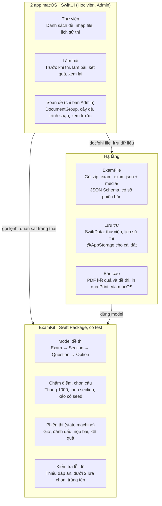
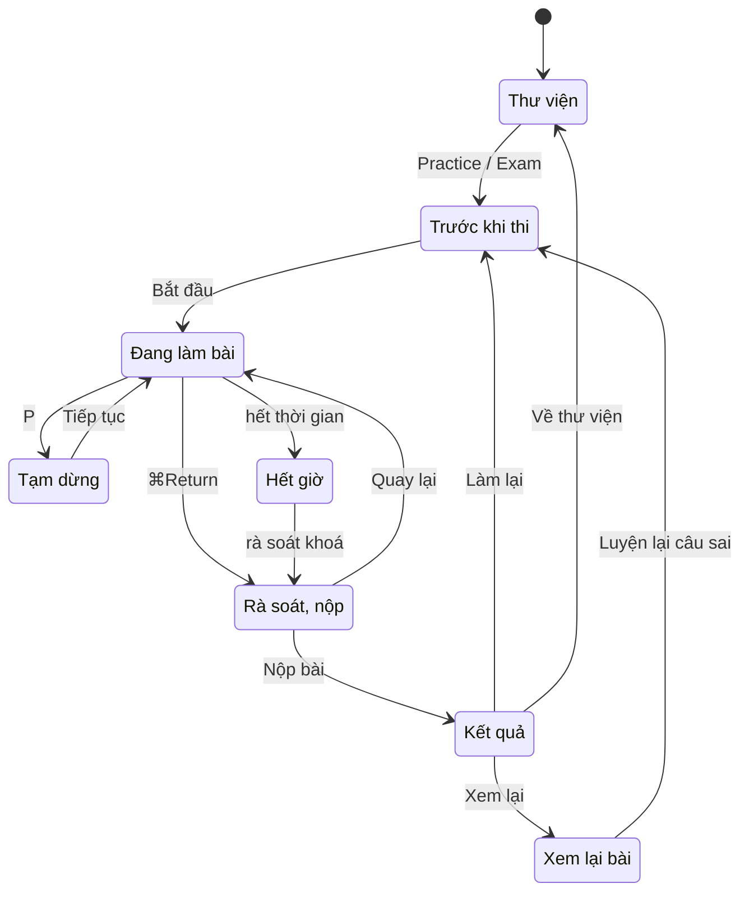
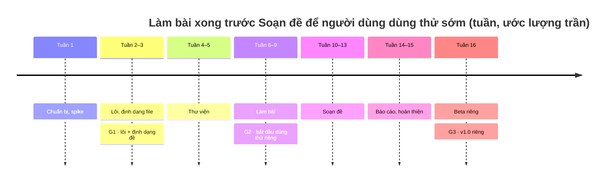

# Kế hoạch xây dựng Exam Suite cho macOS (SwiftUI)

Cập nhật: 15/10/2026 · Nt0

## Tóm tắt

Exam Suite là dự án cá nhân của Nt0 (cập nhật 18/10/2026). Xây app macOS native bằng SwiftUI từ **một codebase, hai bản app**: bản Học viên (Thư viện, Luyện tập/Thi) và bản Admin (thêm Soạn đề). Đề thi lưu ở **định dạng mở: JSON trong một gói zip**, thay cho `.oef`. AI agent viết toàn bộ code; bạn điều phối, duyệt từng PR và test tay trên Mac. Lộ trình giữ 7 giai đoạn và 3 cổng; mốc 16 tuần là ước lượng trần nếu code tay, sẽ đo lại tốc độ thật sau giai đoạn 1.

| Hạng mục | Quyết định |
| --- | --- |
| Công nghệ | Swift 6, SwiftUI, SwiftData, ZIPFoundation; viết mới, không fork code C# |
| Phạm vi v1 | Một codebase, hai bản app: Học viên (Thư viện + Luyện tập/Thi) và Admin (thêm Soạn đề); UX bám theo `docs/DESIGN_BRIEF.md` của repo gốc |
| Quyền soạn đề | Chỉ bản Admin có chế độ Soạn đề; bản Học viên không chứa code soạn đề; cả hai bản phát hành công khai (cập nhật 20/10/2026) |
| Định dạng đề | JSON + ảnh trong một gói zip đuôi `.exam`, có JSON Schema và số phiên bản; không dùng `.oef` |
| Bảo vệ đề | Không ở v1: đề dùng để luyện tập, file mở và đọc được đáp án |
| Phân phối | Phân phối riêng (DMG), chỉ build cho Apple silicon (arm64), chưa lên Mac App Store |
| macOS tối thiểu | macOS 15 Sequoia (mọi Mac Apple silicon đều cài được) |
| Người viết code | AI agent viết toàn bộ; bạn duyệt PR và test tay ở mỗi cổng |
| Harness cho AI agent | repository-harness, thêm 3 cơ chế kiểm soát mượn từ ai-workflow-template (mục Harness cho AI agent) |

Repo gốc được dùng làm **đặc tả** (UX, quy tắc chấm điểm, tình huống test), không chép mã nguồn hay đề mẫu. Lý do: repo theo GPLv3, chép code sẽ buộc app cũng theo GPLv3 (đây không phải tư vấn pháp lý).

Lưu ý: từ 10/10/2026 bản gốc (v5.0.0-preview) đã có bản build macOS bằng Avalonia. Nếu chỉ cần "chạy được trên Mac" ngay, có thể dùng tạm bản đó trong lúc xây app native.

## Phân tích repo gốc

[Open Exam Suite](https://github.com/bolorundurowb/Open-Exam-Suite) là bản thay thế mã nguồn mở cho Visual CertExam Suite, gồm Creator (soạn đề) và Simulator (làm bài), viết bằng C# .NET 10 + Avalonia. Phần logic nhỏ và đã tách khỏi UI, nên dễ dùng làm đặc tả cho bản Swift.

| Thành phần | Vai trò | Quy mô | Dùng cho bản Mac |
| --- | --- | --- | --- |
| `src/Libraries/Core` | Model `Exam`, chấm điểm, chọn câu ngẫu nhiên, undo/redo | ~700 dòng | Viết lại cùng quy tắc |
| `src/Libraries/ExamIO` | Đọc/ghi `.oef` (protobuf + legacy), JSON, XML, xuất PDF | ~1.000 dòng | Chỉ tham khảo; dùng định dạng mới |
| `src/Libraries/Simulator.Engine` | State machine phiên thi (8 trạng thái), cài đặt trước khi thi | ~2.200 dòng | Mô phỏng thiết kế state machine |
| `src/Libraries/Creator.Engine` | Tài liệu soạn đề, kiểm tra lỗi, khôi phục sau crash | ~1.250 dòng | Thay phần lớn bằng kiến trúc document của macOS |
| `src/Libraries/Storage` | Thư viện đề, lịch sử thi, cài đặt (LiteDB) | ~500 dòng | Thay bằng SwiftData |
| `src/Apps/*` | Giao diện Avalonia (MVVM) | ~11.200 dòng | Không dùng |
| `src/Tests/*` | Test xUnit | ~3.750 dòng | Chuyển thành test case Swift |
| `docs/DESIGN_BRIEF.md` | Đặc tả UX chi tiết cho 3 chế độ | — | Đặc tả chính |

Những quy tắc cần giữ đúng khi viết lại:

- **Cấu trúc đề:** Exam → Section → Question → Option. Mỗi câu có nội dung, ảnh tuỳ chọn, một hoặc nhiều đáp án đúng (theo chữ cái A, B, C…) và lời giải thích.
- **Chấm điểm:** đúng/sai theo câu, không có điểm từng phần; câu nhiều đáp án phải chọn đúng toàn bộ tập hợp. Điểm chuẩn hoá = số câu đúng × 1000 / tổng số câu (chia lấy phần nguyên); đậu khi điểm ≥ điểm chuẩn (thang 0–1000; file đề mới lưu điểm chuẩn theo %).
- **Chọn câu ngẫu nhiên:** xáo Fisher–Yates có seed, giữ câu nào thuộc section nào để chấm theo section.
- **Hai chế độ làm bài:** Practice (không giờ, kiểm tra đáp án ngay) và Exam (tính giờ, chỉ có kết quả cuối bài). Cờ `HideAnswers` của đề khoá Practice và ẩn đáp án.

Điểm yếu của bản gốc trên Mac: giao diện Avalonia không theo chuẩn macOS, app phải mang theo runtime .NET (không bật trim/AOT), và bản Avalonia mới ở giai đoạn preview. Repo theo giấy phép [GPLv3](https://github.com/bolorundurowb/Open-Exam-Suite/blob/master/LICENSE).

## Mục tiêu và phạm vi v1

v1 tái hiện đủ các luồng trong DESIGN_BRIEF trên macOS, chia thành hai bản app; phần làm bài làm trước để người dùng dùng thử sớm, phần soạn đề sau.

**Trong v1**

- Thư viện: thêm đề bằng nút hoặc kéo thả, tìm kiếm, lọc, sắp xếp, xem dạng lưới/danh sách, đề mẫu lần đầu mở app, lịch sử các lần thi.
- Trước khi thi: chọn Practice/Exam, tên thí sinh, tất cả câu / theo section / N câu ngẫu nhiên, xáo câu, xáo đáp án, đổi thời gian.
- Làm bài: bảng điều hướng câu, đánh dấu câu, tạm dừng che câu hỏi, cảnh báo còn 5 và 1 phút, hết giờ chuyển sang màn Hết giờ rồi rà soát khoá (chỉ còn bấm Nộp, không tự nộp), nút Check answer ở Practice, thao tác hoàn toàn bằng bàn phím.
- Sau khi thi: màn Review & Submit, kết quả (%, thang 1000, theo section, so với lần trước), xem lại đáp án có bộ lọc, "Luyện lại câu sai", xuất PDF và in.
- Soạn đề (chỉ bản Admin): cửa sổ 3 cột (cây đề, trình soạn, xem trước), ảnh trong câu hỏi, kiểm tra lỗi, undo/redo, tự lưu và khôi phục, "Thử đề này", xuất PDF.
- **Import đề từ các định dạng phổ biến** (chỉ bản Admin; Nt0 yêu cầu 16/10/2026): tạo đề mới từ file câu hỏi có sẵn của người dùng rồi sửa và lưu thành `.exam`. Danh sách định dạng và quy tắc chuyển đổi chốt khi lập plan giai đoạn 4.
- Định dạng đề mở: JSON Schema công khai trong repo, nên AI hoặc script sinh được đề hàng loạt rồi mở trong bản Admin để duyệt.
- Tích hợp macOS: mở file đề từ Finder, menu bar và phím tắt chuẩn, Dark Mode, VoiceOver.

**Ngoài v1**

- Đồng bộ iCloud, nhiều người dùng, ngân hàng câu hỏi online, kết nối LMS.
- Bảo vệ đề (ký số chống sửa, mã hoá đáp án) và đăng nhập SSO: cần khi dùng cho thi thật, để v2.
- Loại câu hỏi mới (kéo thả, điền từ, hotspot): schema có trường `type` nên thêm được ở v2 mà không phá đề cũ.
- Đọc/ghi `.oef` của Open Exam Suite; xuất QTI cho LMS.
- Mac App Store và sandbox; bản iPad/iPhone (có thể dùng lại phần lớn code SwiftUI về sau).

**Tiêu chí hoàn thành**

- Mọi đề do app ghi đều khớp JSON Schema; ghi rồi đọc lại ra đúng dữ liệu, kể cả ảnh.
- Kết quả chấm điểm khớp bộ test viết theo quy tắc của bản gốc.
- Bản Học viên không chứa màn hình và code soạn đề.
- Không mất nội dung đang soạn khi app bị tắt đột ngột.
- Đề 2.000 câu có ảnh vẫn mở và cuộn mượt (con số này là giả định, cần người dùng xác nhận quy mô đề thực tế).

## Kiến trúc kỹ thuật

Toàn bộ logic thi (chấm điểm, chọn câu, phiên thi, kiểm tra lỗi đề) nằm trong một Swift Package thuần, test được không cần giao diện; ba màn hình SwiftUI chỉ hiển thị trạng thái và gửi lệnh.



Hạ tầng chỉ phụ thuộc vào model của ExamKit, nên đổi cách lưu trữ hay định dạng file không chạm tới giao diện.

- **Hai bản app:** hai target Xcode dùng chung các Swift Package. Target Học viên không link module Soạn đề nên không có màn hình hay code soạn đề; mỗi bản một bundle ID (`vn.io.nt0.examsuite`, `vn.io.nt0.examsuite.admin`).
- **Ngôn ngữ và UI:** Swift 6 (strict concurrency), SwiftUI cho toàn bộ giao diện; AppKit chỉ dùng ở chỗ SwiftUI còn thiếu (in ấn, xử lý mở file từ Finder nếu cần).
- **Trạng thái:** view model `@Observable` mỏng cho từng màn hình. Phiên thi là state machine trong ExamKit: nhận lệnh (chọn đáp án, đánh dấu, tạm dừng, nộp) và trả về trạng thái mới, tương tự `SimulatorSession` của bản gốc.
- **Soạn đề (target Admin):** `ReferenceFileDocument` trong `DocumentGroup`. macOS cung cấp sẵn Lưu, Lưu thành, tự lưu, Versions, khôi phục sau crash và `UndoManager`, thay cho hệ thống recovery tự viết của bản gốc.
- **Thời gian:** phiên thi nhận `Clock` từ bên ngoài để test được; đếm giờ theo mốc thời gian; tự tạm dừng khi máy ngủ.
- **Báo cáo:** `ImageRenderer` xuất view SwiftUI ra PDF; in qua `NSPrintOperation`.
- **Thư viện ngoài:** chỉ [ZIPFoundation](https://github.com/weichsel/ZIPFoundation) (MIT, chạy cả trên Linux) để đọc/ghi gói zip; thêm Sparkle khi có Developer ID. ExamKit và ExamFile không phụ thuộc SwiftUI/AppKit để test chạy được cả trên Linux (xem mục Harness cho AI agent).

Phiên thi có 8 trạng thái; mọi đường tới Kết quả đều phải qua bước rà soát:



Practice không tính giờ nên không có nhánh Hết giờ.

## Định dạng đề và dữ liệu

Mỗi đề là **một file zip đuôi `.exam`** gồm `exam.json` và thư mục ảnh `media/`; cấu trúc JSON do một JSON Schema trong repo quy định, có số phiên bản để nâng cấp về sau. Không dùng `.oef` vì người dùng không có file cũ cần chuyển và không cần trao đổi với Open Exam Suite.

```text
Kien thuc chung.exam   (zip)
├── exam.json
└── media/
    └── 7f3c2a1e.png
```

```json
{
  "formatVersion": 1,
  "id": "0b6c1f8e-4d2a-4c1b-9f3e-2a7d5e8c1b40",
  "title": "Kiến thức chung",
  "code": "KTC01",
  "passPercent": 70,
  "timeLimitMinutes": 30,
  "hideAnswers": false,
  "instructions": "Trả lời tất cả các câu.",
  "sections": [
    {
      "id": "5e1d…",
      "title": "Vật lý",
      "questions": [
        {
          "id": "a91c…",
          "type": "single",
          "text": "Đơn vị đo cường độ dòng điện là gì?",
          "image": "media/7f3c2a1e.png",
          "options": [
            { "id": "A", "text": "Vôn" },
            { "id": "B", "text": "Ampe" },
            { "id": "C", "text": "Ôm" }
          ],
          "correct": ["B"],
          "explanation": "Ampe (A) là đơn vị SI của cường độ dòng điện."
        }
      ]
    }
  ]
}
```

| Quyết định | Lý do |
| --- | --- |
| ID ổn định (UUID) cho đề, section, câu | Lịch sử thi và "Luyện lại câu sai" vẫn trỏ đúng câu sau khi sửa hoặc sắp xếp lại đề |
| `type` là `single` hoặc `multiple`, `correct` luôn là mảng | Một cách biểu diễn cho mọi câu; chừa chỗ cho loại câu mới ở v2 |
| `passPercent` 0–100 thay cho thang 0–1000 | Dễ hiểu khi đọc file; màn kết quả vẫn hiển thị cả % và thang 1000 |
| Ảnh là file riêng trong `media/`, đặt tên theo hash nội dung | JSON gọn, không phình base64; ảnh trùng chỉ lưu một lần |
| `text` và `explanation` hỗ trợ Markdown cơ bản | Đậm, nghiêng, code; hiển thị bằng `AttributedString(markdown:)` |
| `formatVersion` + JSON Schema | App báo rõ khi gặp file mới hơn nó; khi tăng phiên bản có bộ chuyển đổi kèm test |
| Không bảo vệ đáp án | Đề dùng để luyện tập; ký số và mã hoá để v2 nếu dùng cho thi thật |

Vì có JSON Schema, AI agent hoặc script sinh được `exam.json` hàng loạt từ tài liệu học; CI kiểm mọi đề mẫu theo schema.

**Dữ liệu riêng của app** (SwiftData, lưu trong Application Support):

- `LibraryEntry`: bookmark tới file (vẫn tìm được khi file bị đổi tên hoặc di chuyển), id đề, tiêu đề, mã đề, số câu, cờ đề mẫu, ngày thêm.
- `Attempt`: id đề, thí sinh, điểm, đậu/trượt, số câu đúng/tổng, thời gian làm, ngày thi, kết quả theo section và câu trả lời theo id câu, để xem lại bài cũ và luyện lại câu sai.
- Cài đặt nhỏ (tên thí sinh gần nhất, giao diện, kiểu xem thư viện) dùng `@AppStorage`.

Model Swift của đề thi (`Exam`, `Section`, `Question`, `Option`) là struct thuần, tách khỏi cả JSON lẫn SwiftData, để đổi cách lưu về sau không ảnh hưởng UI.

## Thiết kế UX trên macOS

Giữ nguyên luồng màn hình của DESIGN_BRIEF, nhưng dùng thành phần chuẩn của macOS thay cho khung Avalonia tự vẽ, để người dùng Mac thấy quen ngay. Màu nhấn theo bản gốc: xanh teal cho Luyện tập/Thi, đỏ burgundy cho Soạn đề; sáng/tối theo hệ thống. Bản Học viên không có nút Đề mới, Sửa và cửa sổ Soạn đề; những thứ này chỉ có ở bản Admin.

| Màn hình | Thành phần macOS | Điểm chính |
| --- | --- | --- |
| Thư viện (cửa sổ chính) | `NavigationSplitView`, `.searchable`, `LazyVGrid` / `Table` | Sidebar: Tất cả đề, Gần đây, Lịch sử thi; menu chuột phải: Practice, Exam, Sửa (bản Admin), Hiện trong Finder, Xoá khỏi thư viện; thẻ báo rõ file mất, hỏng hoặc phiên bản định dạng mới hơn app |
| Trước khi thi | `.sheet` + `Form`, `Picker` dạng segmented, `Stepper` | Dòng tóm tắt sống ("60 câu, 90 phút, đậu 70%"); nút Bắt đầu bị khoá kèm lý do khi ra 0 câu |
| Làm bài | Cửa sổ riêng, cho phép toàn màn hình; bảng câu hỏi trong `.inspector` | Đồng hồ và nút Tạm dừng trên toolbar; Tạm dừng che nội dung câu hỏi; ảnh bấm để phóng to |
| Review & Submit, Kết quả | Trong cùng cửa sổ làm bài; `.confirmationDialog` khi nộp | Hỏi "Còn 6 câu chưa làm. Vẫn nộp?"; kết quả dẫn thẳng sang xem lại |
| Xem lại đáp án | `NavigationSplitView` danh sách + chi tiết | Lọc Tất cả / Sai / Chưa làm / Đã đánh dấu / Đúng; nút "Luyện lại câu sai" |
| Soạn đề | `DocumentGroup`: mỗi file đề một cửa sổ, chỉ có trong bản Admin; `List` kéo thả + `.inspector` xem trước | Cây đề – trình soạn – xem trước; thanh lỗi ở đáy, bấm để nhảy tới câu lỗi; không chặn việc lưu |
| Cài đặt, About | Scene `Settings`, About chuẩn | Changelog hiện một lần sau mỗi bản cập nhật |

| Hành động | Phím tắt |
| --- | --- |
| Chọn đáp án | A–Z |
| Câu trước / câu sau | ← / → |
| Đánh dấu câu | F |
| Tạm dừng | P |
| Câu tiếp theo | Return |
| Mở Review & Submit | ⌘ Return |
| Lưu, Hoàn tác, Làm lại | ⌘S, ⌘Z, ⇧⌘Z (chuẩn macOS, thay cho Ctrl+Y) |
| Thử đề đang soạn | ⌘R |

Trợ năng: mọi nút có nhãn VoiceOver; cảnh báo hết giờ và kết quả Check answer được đọc tự động; trạng thái đúng/sai/đánh dấu luôn có icon + chữ, không chỉ dựa vào màu; tôn trọng Reduce Motion. Chuỗi hiển thị đặt trong String Catalog, có sẵn tiếng Việt và tiếng Anh.

## Lộ trình triển khai

Giữ 7 giai đoạn và 3 cổng kiểm tra; phần làm bài xong trước để người dùng dùng thử trong lúc làm phần soạn đề. Mốc tuần dưới đây là ước lượng trần nếu một người code tay. Với AI agent viết toàn bộ code, nút thắt chuyển sang việc bạn duyệt PR và test tay trên Mac; đo tốc độ thật qua giai đoạn 0–1 rồi cập nhật lại mốc.



| Giai đoạn | Tuần | Đầu ra | Điều kiện qua cổng |
| --- | --- | --- | --- |
| Chuẩn bị, spike | 1 | Repo, Xcode project hai target, Swift Package, CI chạy test; cài repository-harness, AGENTS.md, ADR đầu tiên; spike hai target Học viên/Admin và mở file đề từ Finder | — |
| Lõi, định dạng file | 2–3 | Model, JSON Schema v1, đọc/ghi gói `.exam`, chấm điểm, chọn câu, đề mẫu tự viết | G1: đề mẫu khớp schema, ghi rồi đọc lại không mất dữ liệu, test chấm điểm xanh |
| Thư viện | 4–5 | Cửa sổ thư viện, SwiftData, nhập và kéo thả file, đề mẫu, trạng thái file mất/hỏng | — |
| Làm bài | 6–9 | Trước khi thi, phiên thi, bảng câu hỏi, đồng hồ, tạm dừng, rà soát, kết quả, xem lại bài, phím tắt | G2: nhóm dùng thử làm trọn đề thật, không gặp lỗi chặn (16/10/2026: hoãn tới sau giai đoạn Soạn đề, dùng thử cả hai phần) |
| Soạn đề | 10–13 | `DocumentGroup` (chỉ target Admin), cây đề kéo thả, trình soạn, ảnh, kiểm tra lỗi, undo/redo, xem trước, Thử đề, import từ định dạng phổ biến | — |
| Báo cáo, hoàn thiện | 14–15 | PDF kết quả và đề, in, VoiceOver, Dark Mode, tiếng Việt/Anh, tối ưu đề lớn | — |
| Beta riêng | 16 | Sửa lỗi beta, DMG cho bản Học viên và bản Admin, hướng dẫn cài đặt | G3: không còn lỗi mức cao, đạt tiêu chí ở mục Phạm vi (**đạt 19/10/2026**, bản phát hành riêng v0.1.0) |

Dù agent viết code, mỗi cổng vẫn cần một người test tay trên Mac: giao diện, VoiceOver, mở file từ Finder và cài đặt từ DMG cho cả hai bản app.

Cập nhật 18/10/2026 (Nt0 chốt): từ bước 9 giai đoạn 5, giai đoạn 6 và mọi giai đoạn sau theo nhịp làm việc ở
docs/process/review-and-merge.md mục 4 (một lần `verify_local.sh --uitest` mỗi PR sau review, không PR chỉ kế hoạch hay
tài liệu, xếp chồng tối đa một tầng). Giai đoạn 6 (DMG, ký) làm trong ít PR nhất có thể, không có PR lập kế hoạch riêng:
exec-plan của nó lập trong PR bước 10 của giai đoạn 5; CI GitHub chạy đúng một lần, khi Nt0 báo.

Cập nhật 19/10/2026: **giai đoạn 6 xong, qua G3**, hết lộ trình v1 của bản macOS. Nt0 test tay bản beta (build 349) trên
macOS 26 theo checklist G3: "Không có lỗi"; chưa kiểm trên macOS 15 (không có máy, Nt0 chấp nhận rủi ro). Bản v1 riêng mang số
phiên bản **0.1.0** (Nt0 giữ 0.1.0 cho bản beta riêng): hai DMG đóng từ SHA đã qua cổng `verify_local.sh --clean
--uitest`, gắn tag `v0.1.0` khi Nt0 báo. Kết quả, PR và các bước phát hành:
[plan giai đoạn 6](../plans/completed/giai-doan-6-beta-rieng.md) (Result).

## Kiểm thử và chất lượng

Rủi ro lớn nhất là chấm điểm sai và làm hỏng file đề, nên phần lõi được test kỹ nhất; UI test chỉ phủ các luồng chính.

| Lớp | Công cụ | Phủ những gì |
| --- | --- | --- |
| Lõi (ExamKit) | Swift Testing | Chấm điểm, chọn câu theo section/ngẫu nhiên, mọi chuyển trạng thái của phiên thi, kiểm tra lỗi đề |
| Định dạng đề (ExamFile) | Swift Testing + JSON Schema | Đề mẫu tự viết, đề có ảnh, câu nhiều đáp án, file sai schema, file phiên bản mới hơn app; ghi rồi đọc lại phải ra cùng dữ liệu |
| Hai bản app | Kiểm tra build trên CI | Bản Học viên không chứa module và màn hình Soạn đề; bản Admin mở được đề do AI sinh theo schema |
| Thời gian | `Clock` giả trong test | Cảnh báo 5/1 phút, hết giờ → rà soát khoá → bấm Nộp (không tự nộp), tạm dừng dừng đồng hồ, máy ngủ rồi thức dậy |
| Giao diện | XCUITest | 5 luồng chính trong mục 6 của DESIGN_BRIEF, đều chạy bằng bàn phím; chạy trên Mac của bạn hoặc runner macOS của CI |
| Hiển thị | Snapshot test (sáng/tối) | Câu hỏi dài, 8+ đáp án, ảnh lớn, nhiều section; cửa sổ tối thiểu 960×640 |

Các test xUnit của repo gốc (`ScorerTests`, `ExamComposerRandomTests`, `SimulatorSessionTests`, `ExamFormatFixtureTests`…) là danh sách tình huống nên chuyển sang Swift trước tiên. Kiểm tra thủ mỗi bản beta: VoiceOver, Dark Mode, màn hình ngoài.

## Harness cho AI agent

Chọn **repository-harness** làm nền và mượn thêm ba cơ chế kiểm soát từ ai-workflow-template. ai-workflow-template chặt chẽ hơn, nhưng quá nặng cho dự án 1–2 lập trình viên và gắn với toolchain Node/web; repository-harness nhẹ, không phụ thuộc stack và để dự án tự quyết quy trình.

| Tiêu chí | [repository-harness](https://github.com/hoangnb24/repository-harness) | [ai-workflow-template](https://github.com/tuann2/ai-workflow-template) |
| --- | --- | --- |
| Cách tiếp cận | Giao thức gọn: repo là nguồn sự thật, agent phải dựa vào thẩm quyền và bằng chứng; không áp đặt quy trình | Quy trình có quản trị: 4 vai tách biệt, phong bì quyền, 4 mức rủi ro, bằng chứng gắn snapshot |
| Mỗi tính năng | Tuỳ dự án; có sẵn mẫu exec-plan, decision, runbook | Plan → người duyệt → code → gates → evidence → handoff → review độc lập → release assessment → người duyệt; xác nhận riêng từng vai |
| Kiểm chứng | "Kế hoạch hay thông báo xong không phải bằng chứng"; skill `$encode-invariant` biến quy tắc thành test có đối chứng đúng/sai | Gates chọn theo đường dẫn thay đổi, chặn đường dẫn lạ; `npm run evidence` gắn kết quả vào đúng snapshot |
| Thêm vào repo | Tài liệu + skill; binary Rust để cài và cập nhật (merge 3 chiều, giữ sửa đổi cục bộ, kiểm checksum) | Node 22, TypeScript, vitest; gates viết cho `npm`, profile `web`/`browser` phải viết lại cho Xcode |
| Agent hỗ trợ | Claude Code (`CLAUDE.md` import `AGENTS.md`), Codex, mọi agent đọc `AGENTS.md` | Claude Code, Codex, Antigravity (runbook riêng) |
| Độ trưởng thành | 315 commit, nhiều người đóng góp, có CI và release (harness-v0.1.10), MIT | 45 commit, một tác giả chính, bắt đầu 27/07/2026, MIT; rút ra từ một repo đã chạy 12 vòng quy trình |
| Chi phí với dự án này | Thấp: cài bằng một lệnh, việc chính là điền tài liệu dự án | Cao: chọn stack và thêm ZIPFoundation đều là mức CRITICAL (2 reviewer, 1 adversarial); logic chấm điểm là ELEVATED |

**Cách áp dụng**

1. Tuần 1: cài repository-harness vào repo mới; `docs/README.md` trỏ tới kế hoạch này, DESIGN_BRIEF của repo gốc (dẫn link, không chép), JSON Schema của file đề và các ADR.
2. Ghi vào `AGENTS.md` các lệnh kiểm chứng thật: `swift test` cho ExamKit/ExamFile, `xcodebuild test` cho hai target, SwiftLint, kiểm đề mẫu theo schema; nói rõ phần máy không kiểm được (giao diện, VoiceOver) nên cần người xem.
3. Ghi các quyết định đã chốt thành ADR trong `docs/decisions/`: SwiftUI native, không chép code GPLv3, định dạng `.exam`, hai bản app, macOS 15 + Apple silicon, không bảo vệ đề ở v1.
4. Mỗi giai đoạn trong Lộ trình là một exec-plan trong `docs/plans/active/`; agent cập nhật Progress, Decisions, Validation và chuyển sang `completed/` khi qua cổng.
5. Dùng `$encode-invariant` để biến quy tắc thành test: công thức chấm điểm, mọi đề mẫu khớp JSON Schema, ExamKit không import SwiftUI/SwiftData/AppKit, target Học viên không phụ thuộc module Soạn đề.

**Mượn từ ai-workflow-template**

- **Bằng chứng gắn commit:** chỉ merge khi CI xanh trên đúng commit của PR; tóm tắt của agent không tính là bằng chứng.
- **Review độc lập theo rủi ro:** thay đổi chạm vào chấm điểm, đọc/ghi file đề, lưu file soạn đề hoặc ranh giới giữa hai bản app phải có thêm một phiên agent mới (không mang transcript của phiên code) review trước khi bạn duyệt; thay đổi khác chỉ cần bạn duyệt diff.
- **Giới hạn quyền:** agent làm trên nhánh `feature/*`, không push `main`, không tự merge, không thêm thư viện khi chưa có ADR được duyệt.

Vì AI agent viết toàn bộ code, chạy agent ngay trên Mac của bạn (Claude Code, Codex CLI) cho phần app SwiftUI để agent tự build, chạy XCUITest và đọc lỗi của Xcode. Agent trên cloud dùng Linux nên chỉ hợp cho ExamKit và ExamFile; hai phần này chỉ dùng Foundation và ZIPFoundation để `swift test` chạy được trên Linux. Giữ mỗi PR nhỏ, đúng một mục trong exec-plan, để bạn duyệt được trong một lượt đọc.

Nên đổi sang ai-workflow-template nếu nhiều người hoặc nhiều agent làm song song trên cùng repo, hoặc cần dấu vết kiểm toán đầy đủ cho từng thay đổi. Khi đó phải viết lại `gates-manifest.ts` cho Swift (đường dẫn `.xcodeproj`, `.xcstrings`, `Assets.xcassets`…) trước khi dùng.

## Build và phân phối riêng

Hai bản app, chỉ build cho Apple silicon (arm64), mỗi bản một DMG. Cập nhật 20/10/2026 (repo public, Nt0 chốt): cả hai DMG đăng ở GitHub Releases; trước đó bản Học viên gửi qua ổ chung, bản Admin gửi riêng cho người soạn đề. Bắt đầu không cần tài khoản Apple Developer, nâng cấp khi số người dùng tăng.

- **Dự án:** Xcode project với hai target (Học viên, Admin) + các Swift Package cục bộ (mục Kiến trúc); SwiftFormat/SwiftLint; bundle ID `vn.io.nt0.examsuite` và `vn.io.nt0.examsuite.admin` (từ 18/10/2026); khai báo kiểu file `.exam` (UTType) để Finder mở bằng app, bản Admin đăng ký vai Editor, bản Học viên vai Viewer.
- **CI:** GitHub Actions. Job Linux chạy `swift test` cho ExamKit/ExamFile và kiểm đề mẫu theo JSON Schema; job trên runner macOS Apple silicon build hai target; khi gắn tag thì archive, tạo hai DMG bằng `hdiutil`, đính kèm release. Cập nhật 16/10/2026: để tiết kiệm phút Actions (repo private, macOS tính gấp 10), CI chỉ chạy khi người điều phối báo (dự kiến một lần cho bản beta giai đoạn 6) và khi gắn tag; bằng chứng merge từng PR là `scripts/verify_local.sh` trên Mac của người điều phối (xem docs/process/review-and-merge.md). Cập nhật 19/10/2026 (Nt0 chốt): gắn tag `v*` chỉ chạy job đóng hai DMG và tạo GitHub Release; job Linux và job macOS build hai target chỉ chạy tay.
- **Ký app:**

| Cách | Chi phí | Trải nghiệm người cài |
| --- | --- | --- |
| Ký ad-hoc (Sign to Run Locally) | 0 | macOS chặn lần mở đầu; phải vào System Settings → Privacy & Security → Open Anyway |
| Developer ID + notarize | 99 USD/năm (Apple Developer Program) | Mở bình thường, không cảnh báo; dùng được tự cập nhật |

- **Cập nhật:** giai đoạn beta gửi DMG mới thủ công; khi có Developer ID, thêm [Sparkle](https://sparkle-project.org) để app tự kiểm tra bản mới.
- **Phiên bản:** semver, `CHANGELOG.md` trong repo. Cập nhật 18/10/2026 (plan giai đoạn 6): không có cửa sổ "Có gì mới" trong app (Nt0 bỏ), ghi chú phát hành ở `CHANGELOG.md` và GitHub Release; số build tăng theo mỗi lần đóng DMG (`scripts/make_dmg.sh`, hướng dẫn cài `docs/install.md`).
- **Dữ liệu người dùng:** thư viện và lịch sử thi nằm trong `~/Library/Application Support/<bundle ID>`; app không chạy sandbox ở v1 nên đọc được file ở mọi nơi người dùng chọn.

## Rủi ro, câu hỏi mở và bước tiếp theo

Hai rủi ro cần xử lý ngay tuần 1 là cách macOS mở file đề từ Finder khi máy cài cả hai bản app, và độ ổn định của định dạng đề; các rủi ro còn lại có phương án dự phòng rõ.

| Rủi ro | Ảnh hưởng | Cách xử lý |
| --- | --- | --- |
| Đổi cấu trúc file đề về sau làm hỏng đề cũ | Mất đề hoặc không mở được | `formatVersion` + JSON Schema; app luôn đọc được mọi phiên bản cũ, có test chuyển đổi cho từng phiên bản |
| `DocumentGroup` mặc định mở file từ Finder vào cửa sổ soạn đề; máy admin cài cả hai bản app | Sai kỳ vọng người dùng | Spike tuần 1; bản Admin là Editor, bản Học viên là Viewer; dự phòng: xử lý mở file qua `NSApplicationDelegate` |
| File đề mở: ai có file cũng đọc được đáp án và sửa đề bằng trình soạn thảo | Không dùng được cho thi thật | Chấp nhận ở v1 (đề luyện tập); v2 thêm ký số và mã hoá đáp án nếu cần |
| Người làm bài có bản Admin | Người đó soạn hay sửa được file đề | Chấp nhận từ 20/10/2026: cả hai bản công khai, mã nguồn mở; đề không được bảo vệ ở v1 (ADR 0005). Cần chặt hơn thì v2 ký số đề hoặc đăng nhập |
| AI agent viết code khó duyệt hoặc tự mở rộng phạm vi | Lỗi lọt vào, trễ tiến độ | PR nhỏ theo exec-plan, CI xanh trên đúng commit, review bằng phiên agent mới cho phần rủi ro (mục Harness cho AI agent) |
| SwiftData còn lỗi | Lỗi thư viện/lịch sử | Giữ model đơn giản sau một lớp repository; dự phòng GRDB (SQLite) |
| Đồng hồ sai khi máy ngủ hoặc bận | Tính giờ thi sai | Đếm theo mốc thời gian thay vì cộng dồn; tự tạm dừng khi máy ngủ (bản gốc mới làm được việc này trên Windows) |
| Đề lớn, nhiều ảnh | Mở chậm, tốn RAM | Giải mã ảnh khi cần, cache thumbnail, đo với đề lớn từ giai đoạn 2 |
| Vô tình chép code hoặc đề mẫu GPLv3 | App phải theo GPLv3 | Chỉ đọc repo để hiểu quy tắc, viết lại từ đặc tả, đề mẫu tự soạn; hỏi tư vấn pháp lý nếu sau này phát hành công khai |
| Phạm vi phình ra (loại câu hỏi mới, đồng bộ) | Trễ v1 | Khoá phạm vi theo mục "Ngoài v1", đưa vào v2 |

**Câu hỏi mở**

- Mọi Mac của người dùng đã lên macOS 15 trở lên chưa? Nếu còn máy macOS 14, hạ mức tối thiểu và chấp nhận rủi ro SwiftData.
- Kết quả thi có cần gửi về máy chủ hoặc báo cáo cho quản lý không? Nếu có sẽ ảnh hưởng kiến trúc lưu trữ.
- Agent nào làm chính (Claude Code, Codex…), chạy trên Mac nào để build và chạy UI test?
- Ai duyệt PR và test tay khi bạn vắng?
- Đuôi `.exam` có trùng với phần mềm nào người dùng đang dùng không?

**Bước tiếp theo**

- [ ] Trả lời các câu hỏi mở ở trên
- [ ] Viết JSON Schema v1 và 2–3 đề mẫu thật của người dùng làm fixture
- [ ] Tạo repo, Xcode project hai target, Swift Package và CI; cài repository-harness và điền AGENTS.md
- [ ] Spike: hai target Học viên/Admin; mở file `.exam` từ Finder với `DocumentGroup` + cửa sổ thư viện

---

Bản gốc (có thể sửa và bình luận): https://claude.ai/code/artifact/b7f7055f-a0eb-4cee-8038-496a2d70b8e5
