# Kế hoạch: mở file `.oef` của Open Exam Suite (macOS, iOS, Android)

Soạn: 31/10/2026 · Trạng thái: **Nt0 chốt bảng Quyết định ngày 31/10/2026, như đề xuất** (QO14 đổi: file thử là file
mẫu công khai tải về). O1 chép quyết định vào ADR 0014, exam-format.md (mục File `.oef`, hợp đồng chuyển đổi chính thức),
import.md (mục `.oef`); O2, O3 chép phần của mình vào library.md, mobile.md. Exec-plan:
[plans/active/oef.md](../plans/active/oef.md).

## Tóm tắt

Học viên trên cả ba bản (macOS, iOS, Android) **mở thẳng file `.oef`** do Open Exam Suite (OES) soạn, không cần
người có bản Admin chuyển giúp. Bản Admin thêm `.oef` vào **Import đề…** để chuyển sang `.exam` khi muốn sửa.

Cách làm: một **hợp đồng chuyển đổi** `.oef` → đề (mục mới trong exam-format.md), hai bộ cài đặt (Swift trong
`ExamFile`, Kotlin trong `:core`) và một **oracle chung** trong `fixtures/oef/`, như cách lõi Swift và Kotlin đang
cùng đọc `fixtures/`. Sau bước chuyển, đề là một `ExamPackage` bình thường: chấm điểm, phiên thi, lịch sử, Xem lại,
PDF dùng nguyên.

| Hạng mục | Đề xuất |
| --- | --- |
| Định dạng đọc được | `.oef` bản Protobuf (OES hiện tại). Bản cũ NRBF (BinaryFormatter) và zip + XML: báo lỗi riêng, gợi ý mở bằng OES rồi lưu lại (QO1) |
| Swift (macOS hai bản, iOS) | `OEFReader` trong `ExamFile` (chỉ Foundation, ADR 0008), trả `ExamPackage`; bản Học viên đọc file `.oef` tại chỗ như `.exam` (QO9) |
| Android | `OefReader` trong `:core` (Kotlin thuần); `ExamLibrary.import` chuyển `.oef` thành gói `.exam` rồi lưu bản chép như hiện nay |
| Bản Admin | Import đề… nhận `.oef`, dùng cùng bộ chuyển ở chế độ dễ, báo cáo import như `.vce` |
| Thư viện ngoài | Không thêm (ADR 0006, 0012): tự viết bộ giải mã dây Protobuf, khoảng 150 dòng mỗi ngôn ngữ |
| Thẩm quyền mới | ADR 0014 (đọc `.oef`), sửa Follow-up của ADR 0002, ghi chú ở ADR 0003 (bộ chuyển ở `ExamFile` dùng chung, ranh giới Admin không đổi) |
| Quy mô | **3 PR, 2 cổng**, cả 3 PR rủi ro cao. Khoảng 3 ngày làm (O2 và O3 chạy song song), cộng thời gian Nt0 chốt quyết định, tạo file `.oef` thật và thử trên máy thật |
| Ràng buộc | File thử là file mẫu công khai của OES (QO14), chỉ thử tại máy, không đưa vào git |

Mốc so sánh: spike và bộ đọc `.vce` (định dạng đóng, không đặc tả) xong trong một ngày (PR #30, #38); Android v1 xong 6
PR trong 2 ngày lịch. `.oef` dễ đọc hơn `.vce`; phần tốn công là các luật sản phẩm (id, lỗi, ảnh) và việc giữ hai bộ
cài đặt cho cùng kết quả.

## Phần 1 · Định dạng `.oef`

Nguồn: mã nguồn công khai của [Open Exam Suite](https://github.com/bolorundurowb/Open-Exam-Suite) (GPLv3), đọc qua link
để biết định dạng (ADR 0001: không chép code, không chép file mẫu). Ba thế hệ:

| Thế hệ | Nhận biết | Kế hoạch này |
| --- | --- | --- |
| v1, v2: zip chứa XML và ảnh | Bắt đầu bằng `PK\x03\x04` | Báo "File .oef bản cũ" (QO1) |
| v3: .NET BinaryFormatter (NRBF) | Bắt đầu bằng `00 01 00 00 00 FF FF FF FF` | Báo "File .oef bản cũ" (QO1); OES hiện tại đọc được bản này và lưu lại thành Protobuf |
| Hiện tại: Protobuf (protobuf-net) | Không có magic; thông điệp gốc mở đầu bằng trường 1 | **Đọc** |

Mô hình của bản Protobuf (mọi trường tuỳ chọn trên dây; trường vắng là giá trị mặc định: chuỗi rỗng, 0, false, danh
sách rỗng):

| Thông điệp | Trường | Kiểu trên dây | Ý nghĩa |
| --- | --- | --- | --- |
| Exam (gốc) | 1 Properties, 2 Sections (lặp) | thông điệp | |
| Properties | 1 Title, 2 Code, 6 Instructions | chuỗi UTF-8 | |
| | 3 Version | varint | Số phiên bản đề do người soạn tăng; không có trường tương ứng trong `.exam` |
| | 4 Passmark | double (fixed64) | Ngưỡng đậu thang 1000 (file mẫu của OES: 500, 700) |
| | 5 TimeLimit | varint | Phút |
| | 7 HideAnswers | varint (bool) | |
| Section | 1 Title (chuỗi), 2 Questions (lặp) | | |
| Question | 1 No | varint | Số thứ tự, không dùng |
| | 2 Text, 8 Explanation | chuỗi | Chữ trơn |
| | 3 ImageData | bytes | Nguyên file ảnh, một ảnh mỗi câu |
| | 4 Answer | varint (char UTF-16) | Đáp án của câu một đáp án |
| | 5 IsMultipleChoice | varint (bool) | |
| | 6 Answers | char lặp (packed hay không: spike) | Đáp án của câu nhiều đáp án |
| | 7 Options | thông điệp lặp | |
| Option | 1 Alphabet (varint, char), 2 Text (chuỗi) | | |

File `.oef` **không có id** đề, phần hay câu. Đây là điểm quyết định chi phí: lịch sử thi gắn với id đề và lưu đáp án
theo id câu (exam-taking.md, Dữ liệu một lần thi); Thư viện giữ mỗi id đề một mục (library.md phương án 1), và khi file
tại chỗ đọc lại ra id khác thì mục đó chuyển sang Không tìm thấy file (`LibraryStore`, bước áp kết quả làm mới).

## Phần 2 · Phạm vi và hành vi

### Làm

- Bản Học viên macOS: Thêm đề… (⌘O), kéo thả, mở từ Finder (nhấp đúp, Open With) nhận `.oef` như `.exam`.
- Bản iOS: hộp chọn file, "Mở bằng"/chia sẻ (thư mục `Inbox` dời vào `Received/` như `.exam`), app Tệp mở tại chỗ.
- Bản Android: Thêm đề, "Mở bằng"/chia sẻ nhận `.oef` (bộ lọc intent hiện có đã nhận `application/octet-stream`).
- Bản Admin: Import đề… nhận `.oef`.
- Mọi trạng thái Thư viện (Sẵn sàng, Đề có lỗi, File hỏng…), Làm mới, Tìm file…, Thông tin (thêm dòng định dạng "Open
  Exam Suite (.oef)"), lịch sử thi, PDF kết quả áp cho đề `.oef` như đề `.exam`.

### Không làm

- Ghi `.oef`, xuất sang OES. Đọc bản NRBF hay zip + XML (QO1). Đọc JSON/XML do OES xuất.
- Bản Admin mở `.oef` từ Finder vào cửa sổ soạn đề (QO10): chỉ qua Import đề….
- Đổi định dạng `.exam`, schema, luật chấm điểm.

### Hành vi theo bản

| Chủ đề | macOS Học viên, iOS | Android | Admin |
| --- | --- | --- | --- |
| Đề trong Thư viện | Bookmark tới file `.oef` tại chỗ, đọc và chuyển mỗi lần đọc (QO9) | Chuyển thành gói `.exam` lúc thêm, lưu bản chép `exams/<id>.exam` như hiện nay | Như bản Học viên macOS, đọc dễ |
| Đọc | Nghiêm: đề sau khi chuyển phải qua `ExamValidator`; không qua thì Đề có lỗi, kèm lý do | Nghiêm như `.exam`; không thêm khi lỗi | Import: dễ, giữ câu lỗi để sửa, báo cáo import |
| Sửa file `.oef` ở OES rồi mở lại | Làm mới đọc lại; id đề giữ nếu mã và tiêu đề không đổi (QO2) | Thêm lại: hộp Cập nhật đề như `.exam` | — |
| Cùng đề ở `.oef` và `.exam` do Admin chuyển | Cùng id (QO10): hộp Dùng file mới / Huỷ, lịch sử nối tiếp | Hộp Cập nhật đề | — |

## Phần 3 · Hợp đồng chuyển đổi (bản nháp; bản chính thức ở exam-format.md)

Một bộ luật cho cả Swift và Kotlin. Kết quả phải trùng từng ký tự giữa hai nền tảng (oracle, Phần 6). O1 đã chép thành
mục File `.oef` của exam-format.md, chi tiết hơn bản nháp dưới đây (vị trí byte của dây hỏng, thứ tự kiểm và thứ tự ghi
chú, đường dẫn trường lạ giữ 20 cái đầu, đáp án tính vào giới hạn số phần tử, so chữ cái 64 bit, nối Z bỏ chữ rỗng); các
chỗ khác bản nháp về kết quả: id phần và câu đếm theo file **kể cả** phần, câu bị bỏ (bỏ câu không làm id các câu sau
dời); bản Học viên gặp quá 26 lựa chọn là lỗi riêng (`tooManyOptions`, `OptionID` chỉ có A–Z); câu không có lựa chọn ở
bản Học viên để `ExamValidator` báo.

1. **Nhận diện.** macOS và iOS: theo đuôi `.oef` (UTType nhập, QO11). Android: theo nội dung, vì URI từ app khác có
   thể không có tên: `PK\x03\x04` là gói `.exam`; header NRBF là `.oef` bản cũ; còn lại thử đọc như `.oef`, không
   được thì "không phải file đề". File `.oef` mà là zip hay NRBF: lỗi "bản cũ" (QO1). O3 chốt luật cụ thể của Android
   (zip rỗng `PK\x05\x06` cũng là gói, `.oef` phải mở đầu bằng `0A`): exam-format.md mục File `.oef`, Nhận diện.
2. **Giải mã dây.** Kiểm biên mọi độ dài với phần còn lại của file; varint tối đa 10 byte; kiểu dây phải đúng kiểu của
   trường; chuỗi phải là UTF-8 hợp lệ. Trần: file tối đa 1 GiB (bằng tổng giải nén của gói `.exam`), mỗi ảnh 50 MiB,
   tổng các chuỗi 32 MiB. Trường không có trong bảng Phần 1: bản Học viên từ chối, bản Admin bỏ qua kèm cảnh báo (QO6).
   Trường không lặp mà xuất hiện nhiều lần: theo luật của Protobuf (giá trị vô hướng lấy lần cuối, thông điệp thì
   gộp), không cảnh báo.
3. **Chuỗi.** NFC; cắt khoảng trắng `White_Space` hai đầu (danh sách của exam-format.md). `Text`, `Explanation`,
   `Instructions`, chữ của lựa chọn là chữ trơn: thoát Markdown theo QO7. Chuỗi rỗng sau khi cắt ở trường tuỳ chọn
   (`code`, `instructions`, `explanation`) thì bỏ trường.
4. **Đề.** `title` ← Title. `code` ← Code nếu khớp `[A-Za-z0-9._-]{1,32}`, không thì bỏ (Admin: cảnh báo, QO5).
   `passPercent` ← Passmark/10 làm tròn gần nhất, nửa lên (725 → 73), như import.md phương án 13; Passmark không hữu
   hạn hay ngoài 0–1000 là lỗi (QO4). `timeLimitMinutes` ← TimeLimit; ngoài 1–600 là lỗi của `ExamValidator`.
   `hideAnswers` ← HideAnswers. Version, No: bỏ qua.
5. **Phần.** Theo thứ tự file. Phần không có câu nào bị bỏ (Admin: cảnh báo); không còn phần nào là lỗi "đề không
   có câu nào". Tiêu đề rỗng là lỗi của `ExamValidator` (Admin: tên mặc định theo ngôn ngữ giao diện,
   `DefaultContentNames`, kèm cảnh báo).
6. **Câu.** `text` ← Text. Lựa chọn theo thứ tự file, id đặt lại `A, B, C…` theo vị trí; Alphabet chỉ dùng để tìm
   đáp án. IsMultipleChoice false → `single`, `correct` = [lựa chọn có Alphabet = Answer]; true → `multiple`, `correct`
   = các lựa chọn có Alphabet thuộc Answers, theo thứ tự lựa chọn, không lặp. Alphabet trùng trong một câu, hay đáp án
   không khớp lựa chọn nào: lỗi (Học viên), câu giữ lại với đáp án đã khớp được và cảnh báo (Admin). Quá 26 lựa chọn,
   dưới 2 lựa chọn: lỗi của `ExamValidator` (Admin theo luật hiện có của import.md: câu không có lựa chọn bị bỏ).
7. **Ảnh.** ImageData rỗng: không có ảnh. Loại ảnh nhận theo byte đầu: PNG, JPEG, GIF, WebP, HEIC → đuôi `png`,
   `jpg`, `gif`, `webp`, `heic`; đường dẫn `media/<16 ký tự hex đầu của SHA-256>.<đuôi>` (`MediaNaming`). Loại khác
   (BMP, TIFF…): Học viên từ chối, Admin bỏ ảnh kèm cảnh báo (QO8). Ảnh trùng nội dung dùng chung một đường dẫn.
8. **Id** (QO2, QO3), UUID phiên bản 8 (RFC 9562) từ SHA-256: lấy 16 byte đầu, đặt bit phiên bản và biến thể, viết
   chữ thường.
   - Đề: SHA-256 của `"oef-exam\u{0}" + code + "\u{0}" + title` (chuỗi sau bước 3 và 4; `code` vắng là chuỗi rỗng).
   - Phần thứ i, câu thứ j (đếm từ 0, sau bước 5): SHA-256 của `"<id đề>/s<i>"` và `"<id đề>/s<i>/q<j>"`.
9. **Kiểm.** Bản Học viên đọc nghiêm: `ExamValidator` trên đề đã chuyển, cùng tập ảnh; lỗi mức `error` thì từ chối như
   `.exam`. Bản Admin đọc dễ, lỗi hiện trên thanh lỗi như mọi đề.

Hệ quả cần ghi vào exam-format.md: sửa thứ tự câu hay phần trong OES làm câu đổi id; lần thi cũ khi Xem lại sẽ thấy các
câu dời chỗ là "câu đã sửa" (dấu vân tay khác), không đánh dấu sai đáp án. Hai đề khác nhau cùng mã và tiêu đề bị coi
là một đề (QO2).

## Phần 4 · Kiến trúc

### Swift

- `Packages/ExamKit/Sources/ExamFile`: `ProtobufWire` (giải mã dây, có trần), `OEFReader.read(contentsOf:mode:)` →
  `ExamPackage` (ảnh trong `media` như gói `.exam`), ghi chú chuyển đổi có mã cho báo cáo import của Admin;
  `ExamFileError` thêm case có mã `OEFProblem` (bản cũ, dây hỏng, trường lạ, ảnh không hỗ trợ, đáp án không khớp…);
  một hàm chọn bộ đọc theo đuôi, ví dụ `ExamSourceReader.read(contentsOf:mode:)` (`.exam` → `ExamPackageReader`,
  `.oef` → `OEFReader`). Băm dùng `SHA256.swift` có sẵn (chạy cả Linux).
- Bản Học viên đọc file ở đúng hai chỗ, đổi sang hàm chọn bộ đọc: `ExamFileInspector.defaultReader` (LibraryData:
  thêm, làm mới, Tìm file…) và bộ đọc mặc định của `SessionServices` (SessionModel: Trước khi thi, làm bài, Kết quả,
  Xem lại, PDF). `ExamFileInspector.inspectNewFile` nhận thêm đuôi `oef`; `lenientMightSucceed` xét các case mới.
- `UTType.examSourceTypes` (`.examPackage` + UTType `.oef`) cho `fileImporter` của `LibraryRootView` (macOS) và
  `LibraryScreen` (iOS), `dropDestination` của Thư viện; `StudentShell.application(_:open:)` và `onOpenURL` của
  `MobileShell` đi qua `LibraryStore` nên không đổi.
- `project.yml`: UTType nhập cho `.oef` và `CFBundleDocumentTypes` hạng Alternate ở `ExamSuite` và `ExamSuiteiOS`
  (QO11); bản Admin chỉ cần UTType nhập cho hộp chọn của Import đề….
- Câu báo lỗi: `ErrorMessages` (InterfaceCore) thêm câu cho `OEFProblem`, chữ "không phải file đề .exam" thành ".exam
  hay .oef"; catalog vi/en.
- Bản Admin: `ExamImporter.supportedExtensions` thêm `oef`; bộ chuyển ghi chú → `ImportReportEntry`; hộp xác nhận điền
  sẵn tiêu đề, mã, ngưỡng, thời gian như `.vce`; id dẫn xuất thay id ngẫu nhiên (QO10); `AuthoringMessages` thêm câu.

### Kotlin

- `:core`: `ProtobufWire`, `OefReader` cùng luật, trả đề và ảnh; `ExamPackageWriter` tối thiểu (zip `exam.json` +
  `media/`, `java.util.zip`) để chuyển sang gói `.exam`; lỗi có mã thêm vào `ExamFileError`.
- `:data`: `ExamLibrary.import` nhận diện theo nội dung (Phần 3 bước 1), chuyển `.oef` thành gói trong
  `exams/.incoming/` rồi chạy tiếp luồng hiện có (`readStrict`, trùng id → Cập nhật đề). Không đổi Room schema.
- `:app`: `Messages.kt` và `strings.xml` (vi, en) thêm câu lỗi; bộ lọc intent và hộp chọn `*/*` không đổi.

## Phần 5 · Lộ trình

```mermaid
gantt
  title .oef: 3 PR, 2 cổng
  dateFormat X
  axisFormat %s
  O1 Hợp đồng, oracle, bộ đọc Swift, Admin import :o1, 0, 1
  GO1 Admin import file .oef thật                  :milestone, after o1, 0
  O2 Bản Học viên macOS và iOS                     :o2, after o1, 1
  O3 Android                                        :o3, after o1, 1
  GO2 Học viên mở .oef trên ba bản                  :milestone, after o2 o3, 0
```

| Bước | Đầu ra | Phụ thuộc | Rủi ro / review | Kiểm chứng trong PR |
| --- | --- | --- | --- | --- |
| **O1 Hợp đồng và bộ đọc Swift** (1 PR, ~3.000 dòng) | Spike trên file mẫu công khai của OES (QO14: packed hay không của Answers, giá trị mặc định có được ghi không), kết luận vào Decisions; ADR 0014, sửa ADR 0002 và 0003, exam-format.md (Phần 3), import.md (mục `.oef`), docs/README.md; exec-plan `docs/plans/active/oef.md`; `fixtures/oef/` + `scripts/make_oef.py` (chỉ thư viện chuẩn, sinh file từ mô tả JSON, `--check` so byte); `ProtobufWire`, `OEFReader`, hàm chọn bộ đọc trong `ExamFile`; Admin: Import đề… nhận `.oef` | Quyết định QO1–QO8, QO10, QO14 (đã chốt) | **Cao** (`ExamFile`, `fixtures/`): 1 review độc lập | Oracle Swift trên `fixtures/oef/` (đề đã chuyển, mã lỗi, id, tên ảnh); cắt cụt ở mọi vị trí, đột biến có seed, độ dài khổng lồ: chỉ ra lỗi có mã, không crash hay treo (như `VceImportTests`); `ImportFlowTests` thêm ca `.oef`; `make_oef.py --check` trong `check.sh` bước 3 |
| **O2 Học viên macOS và iOS** (1 PR, ~1.200 dòng) | Hai điểm đọc của bản Học viên đổi sang hàm chọn bộ đọc; `inspectNewFile`, hộp chọn file, kéo thả nhận `.oef`; UTType và document type trong `project.yml`; Thông tin hiện định dạng; câu báo lỗi vi/en; library.md, mục "Bản iOS" của mobile.md | O1; iOS I3 đã merge (QO12) | **Cao** (`project.yml`, `Apps/**`, InterfaceCore): 1 review độc lập | `LibraryDataTests`: thêm `.oef` Sẵn sàng / Đề có lỗi / bản cũ, sửa nội dung tại chỗ giữ id, đổi tiêu đề thành Không tìm thấy file, Tìm file…; `check_localization.py --require-en`; `check_bundle_boundary.sh` không đổi; XCUITest iOS luồng 2 thêm một đoạn mở file `.oef` (không thêm lần mở app); macOS: mở từ Finder thử tay ở GO2 (UI test không lái được Finder) |
| **O3 Android** (1 PR, ~2.000 dòng) | `:core` `ProtobufWire`, `OefReader`, ghi gói `.exam`; `:data` nhận diện và chuyển lúc thêm; chuỗi vi/en; mục Android của mobile.md; `android/CHANGELOG.md` | O1 (oracle, hợp đồng) | **Cao** (`android/core/**`): 1 review độc lập | `SharedOracleTest` đọc `fixtures/oef/` (trùng kết quả với Swift); cắt cụt và đột biến như Swift; `ExamLibraryTest` thêm `.oef`; `ExamIntentFlowTest` thêm một đoạn mở `.oef`; `check_android.sh`, `check_android.sh --ui` |

O2 và O3 rẽ từ `main` sau khi O1 merge, làm song song (mỗi lúc một việc nặng trên Mac). Không PR riêng cho tài liệu:
plan này, ADR và exec-plan đi cùng O1.

**Cổng GO1** (sau O1, Nt0 thử trên Mac): Import đề… với file `.oef` mẫu của OES và file Nt0 có (QO14), so với OES: số câu, đáp án, ảnh,
ngưỡng, thời gian; lưu `.exam`, mở bằng bản Học viên. Đây cũng là phương án A đã có giá trị riêng nếu dừng ở đây.

**Cổng GO2** (sau O2 và O3, máy thật): nhấp đúp `.oef` trong Finder; iPhone nhận `.oef` qua app Tệp và Zalo; Android
qua Zalo hoặc Drive; làm một bài Thi trên mỗi máy; sửa một câu trong OES rồi mở lại (Xem lại báo câu đã sửa); thêm
`.exam` do Admin chuyển từ cùng file (hộp Dùng file mới / Cập nhật đề, lịch sử nối tiếp).

## Phần 6 · Kiểm thử

Dùng lại các lớp hiện có; chỉ thêm phần cho hành vi mới (review-and-merge.md mục 4: không thêm lớp kiểm trùng).

| Lớp | Thêm |
| --- | --- |
| Oracle chung | `fixtures/oef/*.oef` sinh bằng `scripts/make_oef.py` từ `fixtures/oef/src/*.json` (đề tự soạn, ảnh tự vẽ); `fixtures/oef/expected.json`: kết luận đọc nghiêm/dễ, mã lỗi, và với file hợp lệ là `exam.json` đã chuyển (id, ảnh, chữ đã thoát Markdown). Ca âm: bản cũ NRBF và zip dựng tối thiểu, dây hỏng, trường lạ, Alphabet trùng, đáp án không khớp, ảnh BMP, Passmark ngoài thang, phần rỗng |
| Bền vững | Cắt cụt ở mọi vị trí và đột biến có seed trên file trong `fixtures/oef/`, ở cả Swift và Kotlin |
| Thư viện | `LibraryDataTests` (Swift), `ExamLibraryTest` (Kotlin), các ca ở bảng O2, O3 |
| Admin | `ImportFlowTests`, `AuthoringMessagesTests` |
| Chuỗi | `ErrorMessagesTests`, `check_localization.py --require-en`; Android lint `MissingTranslation` |
| Giao diện | iOS luồng 2 và `ExamIntentFlowTest` thêm một đoạn mỗi test; không thêm snapshot (giao diện không đổi ngoài dòng Thông tin) |
| Hiệu năng | Một ca trong test `Timing` hiện có: đề chuẩn 2.000 câu, 200 ảnh mã hoá thành `.oef` bằng bộ ghi chỉ cho test trong `LargeExamSupport`, so giới hạn "mở đề" của large-exams.md |

`verify_scope.py`: `fixtures/oef/**` và `make_oef.py` vào bảng (mức `core` nếu chỉ lõi Swift đọc, `full` nếu
`LibraryDataTests` cũng đọc; chốt ở O1, có ca trong `--self-test`).

## Phần 7 · Rủi ro

| Rủi ro | Cách xử lý |
| --- | --- |
| Chi tiết mã hoá của protobuf-net khác suy đoán (char lặp packed hay không, giá trị mặc định có ghi không) | Spike O1 trên file thật; bộ đọc nhận cả hai dạng của trường lặp; oracle có cả hai |
| OES đổi định dạng (thêm trường, đổi số trường); file không có số phiên bản định dạng | Học viên từ chối trường lạ với câu báo rõ (QO6); Admin import bỏ qua và cảnh báo; theo dõi OES khi có phiên bản lớn |
| Hai đề khác nhau cùng mã và tiêu đề bị coi là một | Hộp Dùng file mới / Cập nhật đề hiện ra nên người dùng thấy; ghi trong exam-format.md (QO2) |
| Sửa đề trong OES làm câu đổi id, Xem lại lần cũ báo nhiều câu đã sửa | Chấp nhận: không sai đáp án vì dấu vân tay chặn; ghi trong exam-format.md |
| Ảnh BMP/TIFF từ OES trên Windows làm bản Học viên từ chối đề | Câu báo nêu ảnh không hỗ trợ và gợi ý chuyển bằng bản Admin (QO8) |
| Hai bộ cài đặt lệch nhau | Oracle chung trong `fixtures/oef/`; đổi luật thì sửa oracle trước (như luật lõi Kotlin hiện có) |
| Android đoán nhầm file nhị phân bất kỳ là `.oef` | Chỉ file mở đầu bằng khoá của Properties (`0A`) hay header bản cũ mới đọc như `.oef`; còn lại "không phải file đề" (O3, exam-format.md mục File `.oef`, Nhận diện). File chữ mở đầu bằng dòng trống vẫn vào bộ đọc và báo dây hỏng |
| Pháp lý | Thấp hơn `.vce`: định dạng của dự án mã nguồn mở; viết mới, không chép code hay file mẫu GPL (ADR 0001); ghi trong ADR 0014 |
| Đuôi `.oef` trùng file bài tập dạng chữ của WIMS (tìm trên GitHub ra toàn file WIMS) | Byte đầu của file chữ không mở được thông điệp Protobuf: "dữ liệu hỏng… hoặc không phải đề của Open Exam Suite"; fixture `van-ban-wims` |
| Đặt tên ảnh phải băm SHA-256 mọi ảnh mỗi lần đọc: đề chuẩn 60 MB ảnh mất 14 s ở bản Debug (O1, test `oef.read`) | O1 viết lại vòng nén của `SHA256` (con trỏ, phép dịch có mặt nạ): 1,1 s ở Debug; `SHA256Tests` giữ đúng kết quả |
| O2 trùng thời gian với I3 của iOS | O2 sau khi I3 merge (QO12) |

## Quyết định (Nt0 chốt 2026-10-31)

Nt0 trả lời "chốt như đề xuất" ngày 31/10/2026; riêng QO14: file thử tải trên mạng hoặc GitHub. O1 chép vào ADR 0014,
exam-format.md, import.md.

| # | Câu hỏi | Đề xuất | **Chốt** |
| --- | --- | --- | --- |
| QO1 | Đọc thế hệ nào? | Chỉ bản Protobuf. NRBF và zip + XML báo "File .oef bản cũ: mở bằng Open Exam Suite rồi lưu lại" || **Như đề xuất** |
| QO2 | Id đề lấy từ đâu? | Từ mã + tiêu đề (Phần 3 bước 8): sửa câu trong OES vẫn là cùng đề, lịch sử nối tiếp. Phương án khác: từ toàn bộ nội dung file, nhưng mọi lần sửa sẽ thành đề mới và mục cũ trên macOS/iOS hiện Không tìm thấy file || **Như đề xuất** |
| QO3 | Id phần và câu? | Theo vị trí trong file || **Như đề xuất** |
| QO4 | Ngưỡng đậu? | Passmark/10 làm tròn nửa lên, như import.md phương án 13; ngoài 0–1000 là lỗi || **Như đề xuất** |
| QO5 | Bản Học viên gặp giá trị sai? | Chỉ chuẩn hoá chỗ chắc chắn (NFC, cắt khoảng trắng, bỏ mã sai mẫu, bỏ phần rỗng); còn lại là Đề có lỗi kèm lý do, gợi ý chuyển bằng bản Admin || **Như đề xuất** |
| QO6 | Trường lạ trên dây? | Học viên từ chối (như trường lạ của `.exam`); Admin bỏ qua, cảnh báo || **Như đề xuất** |
| QO7 | Thoát Markdown cho chữ trơn của OES? | Luôn thoát `\`, `` ` ``, `*`, `_`, `[`, `]`, `<`, `>`, `~`: hai nền tảng cho cùng kết quả. `&` không thoát vì bộ Markdown của Android không nhận `\&`. Đổi lại, bản Admin sẽ thấy dấu `\` khi sửa đề import từ `.oef`. Phương án khác: không thoát (cặp `*…*` trong chữ sẽ thành nghiêng) || **Như đề xuất** |
| QO8 | Ảnh ngoài sáu định dạng? | Học viên từ chối đề; Admin bỏ ảnh, cảnh báo || **Như đề xuất** |
| QO9 | macOS và iOS giữ `.oef` thế nào? | Bookmark tại chỗ, chuyển mỗi lần đọc: library.md không đổi, sửa trong OES thấy ngay sau Làm mới. Phương án khác: chuyển một lần thành `.exam` trong thư mục của app || **Như đề xuất** |
| QO10 | Bản Admin? | Import đề… nhận `.oef` với id dẫn xuất (khác luật id ngẫu nhiên của import.md) để `.exam` chuyển ra cùng id với `.oef`; không mở `.oef` từ Finder || **Như đề xuất** |
| QO11 | Vai với Finder và "Mở bằng"? | UTType nhập `vn.io.nt0.examsuite.oef` (OES không khai báo UTType, chỉ đăng ký đuôi), hạng Alternate: máy có OES thì OES vẫn mở mặc định || **Như đề xuất** |
| QO12 | Thứ tự với iOS? | O1 làm ngay; O2 sau khi I3 merge, không làm chậm cổng GI3; O3 song song O2 || **Như đề xuất** |
| QO13 | Phát hành? | macOS 0.2.0, Android 0.2.0 (`android-v0.2.0`), iOS ở bản kế sau 0.1.0 || **Như đề xuất** |
| QO14 | File `.oef` thật để thử? | Nt0 tạo bằng OES Creator bản hiện tại: một đề có ảnh PNG và JPEG, câu nhiều đáp án, ẩn đáp án, nhiều phần; thêm file từ máy Windows nếu có (ảnh BMP). Chỉ thử tại máy, không vào git || **Đổi**: file mẫu công khai của repo Open Exam Suite (2 file Protobuf, 4 file bản cũ theo lịch sử repo), tải về thư mục tạm, thử tại máy, không vào git; không có file mẫu có ảnh hay câu nhiều đáp án nên phần đó phủ bằng fixture tự dựng |

## Việc Nt0 cần làm

- Chốt bảng Quyết định.
- Có mặt khi chạy `verify_local.sh --uitest` (Automation Mode), iPhone và máy Android cho cổng GO2.

## Hướng dẫn cho agent nhận plan

1. Đọc `AGENTS.md`, `docs/WORKFLOW.md`, plan này, exam-format.md, import.md, library.md, exam-taking.md (Dữ liệu một
   lần thi), mobile.md, ADR 0001, 0002, 0003, 0006, 0008, 0009 (cách làm bộ đọc định dạng ngoài), 0011, 0012,
   review-and-merge.md.
2. Bảng Quyết định phải được Nt0 chốt trước O1; câu nào chưa chốt thì dừng, hỏi, không tự chọn mặc định (luật chấm
   điểm và định dạng mơ hồ: AGENTS.md).
3. Đọc mã nguồn OES chỉ qua link để biết định dạng; không chép code, không chép file mẫu vào repo.
4. Mỗi bước một PR trên nhánh `feature/oef-<bước>`; cập nhật exec-plan trong cùng PR; không push `main`, không tự merge.
5. Đổi luật chuyển đổi thì sửa exam-format.md và oracle `fixtures/oef/` trước, rồi tới hai bộ cài đặt.
